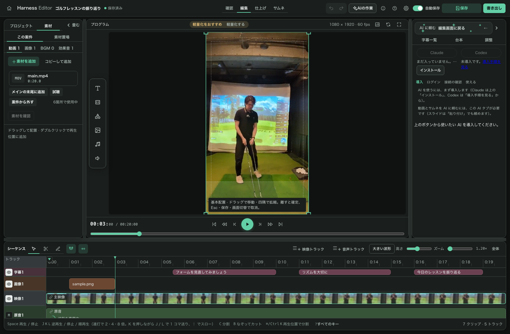

# MCP 接続マニュアル — エディタから Claude に編集を頼めるようにする

所要時間: **約1分**（「0. いちばん簡単な方法」の場合。導入が要る初回だけ数分）

---

## 0. いちばん簡単な方法（推奨・2026-07 追加）

エディタの **AI タブ** に Claude のターミナルが内蔵されました。ターミナルアプリを別に開いたり、
コマンドを貼り付けたりする必要はありません。

1. 右ドックの **AI タブ**を開く。
   - Claude Code がまだパソコンに入っていなければ、「**AI と接続する（Claude Code を導入）**」ボタンが出るので押す（初回のみ・数分）。
   - すでに入っていれば、ボタンを押さなくても自動で接続が始まる。
2. 画面内にターミナルが表示され「claude に接続しています…」のあと本物の Claude が起動する。**初回だけ**、通常の `claude` 起動時と同じログイン画面が出るので、いつも通りログインする（2回目以降はログイン不要）。
   - MCP（`sme-editor` ツール）はすでに自動設定済みなので、`claude mcp add` は不要。
3. AI が起動すると、今開いている案件とモードを 1 行であいさつします（例「10月の講義（動画）を見ています。何をしましょう？」）。待機のボタンはありません。

あとは AI タブの入力欄に日本語で「冒頭を詰めて」のように打って Enter を押せば、AI が編集します。
案件やモード（動画・スライド・サムネ）を切り替えても、AI は依頼のたびに今の画面を確かめます。依頼した後に別の案件へ移った場合は、
AI がどちらの案件か確かめてから進めます（確かめずに別の案件へ書き込むことはエディタが止めます）。

### AI タブの AI が最初に読む説明書（2026-10 追加）

AI タブの AI は、起動した時の最初の依頼と、エディタとの接続（MCP）の説明の両方で、次の説明書を受け取ります（文言は `src/shared/agentPrompts.ts` の `EDITOR_BRIEF` と同じ）。

> このエディタ（Harness Editor）では、動画・スライド・サムネを MCP の sme-editor の道具で編集できる。依頼を受けたら毎回、最初に editor_context を呼び、利用者が今見ている案件とモード、依頼した時点の案件を確かめる。switchedSinceRequest が true なら、どちらの案件を直すか利用者に確かめてから進める。screen が null なら推測で案件を決めず、案件を開いてもらう。モード別の手順は editor_guide（mode に video・slides・thumbnail）で読む。書き込みが TARGET_NOT_REQUESTED で断られたら、利用者に対象を確かめる。依頼文の末尾に「（依頼 #番号）」がある依頼は、終わったら report_instruction_status に id（#番号）と結果（done か failed と一言）を返す。返事は日本語で短く。

モード別の詳しい手順は、AI が必要な時に道具 `editor_guide` で読みます（スライドの手順は 7 節）。

### Claude と Codex を切り替える（両方パソコンに入っている場合・2026-07 追加）

パソコンに **Claude Code と Codex の両方**が入っていれば、ターミナルの上に切替ボタン
（Claude / Codex）が出ます。**Claude だけが入っている場合はこのボタンは出ず、画面はこれまでと
何も変わりません。**

切替ボタンを押すと確認が出ます（実行中の編集は中断され、会話の内容も残りません）。OK すると
選んだ方のツールが新しく起動します。

切り替えると、選んだ方の AI が新しく起動して、同じように今の画面を 1 行であいさつします（最初の依頼は起動のたびに 1 回だけ AI に渡ります）。

**Codex を使うための前提**（任意・使わない場合は無視してよい）: ターミナルで
`npm i -g @openai/codex` を実行して **版 0.145.0 以上**を導入し、ChatGPT にログイン済みであること。
Codex は自動導入ボタンの対象外のため、使いたい場合は先にターミナルで導入しておく。ログイン状態は
このパソコンの Codex のものをそのまま引き継ぐため、埋め込みターミナルで改めてログインする必要は
ない。**初回だけ**、このフォルダを信頼するか確認する英語の画面が出るので、Enter を押せば進める
（2回目以降は出ない）。

---

## 1. MCP とは？（1分で理解）

> 以下は「別ターミナル運用（上級者向け）」の背景知識と手順です。上の「0. いちばん簡単な方法」
> だけで普段の利用は完結します。

MCP（Model Context Protocol）は、**Claude がこのエディタの中を見たり操作したりするための「ドア」** です。

ドアを一度つないでおくと、エディタ右側の **AI タブ** に日本語で指示を打つだけで、Claude Code がテロップの色変更・文言修正・タイミング調整などを裏側でやってくれます。



しくみはシンプルです:

```
エディタの AI タブ（あなたが指示を打つ）
        ↓ 受け箱に指示が入る
Claude Code（ターミナルで待機している）が指示を取りに来る
        ↓ 対象の編集画面を確認し、共通の編集操作を実行・保存
エディタの画面に結果が反映される
```

独自プレビュー版の案件では、AIも開いている編集画面の状態を読み、同じUndo・保存経路で変更します。旧ファイルや `project.v2.json` を直接書き換える運用は使いません。字幕本文に加え、カット・字幕タイミング・登録済み素材の配置などは型付きのタイムライン操作で依頼します。利用可能操作は `editor_read` の返答を確認してください。未接続・未保存・結果不明のときは、完了したと報告せず、画面の状態を確認します。

`editor_read` に `sessionId` と `section`（`clips` / `assets` / `tracks` / `cuts` / `transcripts`）を指定すると、同じ編集文書の必要な情報を100件まで取得できます。発話は単語ごとです。続きは `nextOffset` と最初に返された `revision` を使います。版が変わった場合は最初から読み直してください。

タイムライン操作では、通常の `projectId`・`operationId`・`baseRevision` に加え、`changes: []` と `sequence: {documentId, commands: [...]}` を指定します。例：`commands: [{type: "ripple-delete", startFrame: 300, endFrame: 330}]`。時刻は `editor_read` のfpsを使った完成タイムラインのフレームです。先に `editor_validate`、次に同じ要求を `editor_apply` へ渡し、`editor_runs` で保存を確認します。複数操作はまとめて1回のUndoになります。素材のパス・コード・編集文書全体を要求に含めることはできません。

動画をメインの末尾に並べる依頼は `editor_import_media` を使います。`sessionId`・`projectId`・`operationId` と、許可された場所（外付け・デスクトップ・ダウンロード・ムービー）にある動画の絶対パスの配列 `paths`、置き方 `placement: "append-main"` を指定します。パスは実パスへ解決してから許可された場所かを確かめるため、外の場所や、外を指すリンクは断られます。並び順はファイル名の自然順です。全件の準備が終わると、開いている編集画面が1回の編集（Undo 1回）でメインの末尾に並べます。進み具合と確定の結果は `editor_import_runs`、未配置の束の取り消しは `editor_import_cancel` で扱います（どちらもAIが作った束だけ）。`confirmed` は開いている編集画面に並んだ状態で、保存は画面の自動保存か人の保存で行われます。確定が再試行しても通らない理由（速度を設定した案件など）で断られた束には `refusal` が付きます。人の未保存の編集がある間と、速度を設定した案件では、新しい取り込みを受け付けません。同じ `operationId` の再送は、パスを確かめ直す前に既存の束を返します。取り込みの操作の記録（案件の `.harness/imports/operations.json`）が壊れている間は、同じ動画を二重に並べないよう、その案件では AI からの取り込みを断ります（AI には内部エラーとして返ります）。AI の取り込みが内部エラーで続けて失敗する時は、画面の「素材を追加」から取り込み、記録の修復はエラーの内容を添えて依頼してください（記録を消すだけでは、整理済みの古い操作の再送で二重に並ぶことがあります）。

---

## 2. 前提条件

| 必要なもの | 確認方法 |
|---|---|
| Claude Code が入っている | ターミナルで `claude --version` が表示される |
| エディタが起動できる | いつも通り `npm run edit` で画面が開く |

これだけです。追加のインストールは不要です。

---

## 3. 別ターミナル運用（上級者向け・従来手順）

エディタ内蔵ターミナル（「0. いちばん簡単な方法」）は「全体待機」1本のみで、動画専属モードは選べません。
**動画ごとに専属の Claude を分けたい**場合や、外部のターミナルアプリで自分好みに操作したい場合はこちら。

### ステップ1: エディタを起動する

いつも通りエディタを立ち上げます（ポート 2109 で待ち受けます）。

### ステップ2: MCP を登録する（**初回のみ・1回だけ**）

ターミナルで **このエディタのフォルダ（harness-editor）に移動してから**、次を貼り付けます:

```bash
claude mcp add --transport http sme-editor http://localhost:2109/mcp
```

> **重要**: このコマンドは「Claude を起動するフォルダ」で実行します。別のフォルダで登録すると、そのフォルダで起動した Claude からしか見えません。

### ステップ3: Claude を「待機役」として常駐させる（**使うたび**）

待機役の使い方は 2 つから選べます。迷ったら A で始めてください。

#### A. 全体待機（推奨・並列）— 1 つの待機役が全部の動画を担当

同じフォルダで `claude` を起動し、次をそのまま貼り付けます:

```
/loop sme-editor の get_next_instruction を呼んで編集指示を待つ。指示が返ったら、その場では編集せずバックグラウンドの subagent に委譲して、すぐ次の get_next_instruction を呼びに戻る。subagent には次の編集手順と、元の指示 ID・projectId を渡す。まず editor_projects と editor_read で指示の projectId に一致する編集画面と現在版を確認する。接続先を省略して別案件を編集しない。documentFormat が sequence-v2 の案件では、project.v2.json や旧編集ファイルを直接書き換えず、editor_read で得た ID・版・変更前本文・reference を使い、カットや素材調整には section で clips・assets・tracks・cuts・transcripts を読み、changes は空配列、sequence は documentId と型付き commands にして渡す。続きの取得には初回の revision を指定し、同じ素材でも使用箇所を ID で区別する。字幕本文だけの修正は既存の changes も使える。editor_validate、editor_apply の順で編集を依頼し、返った runId を editor_runs で確認する。動画をメインの末尾に並べる依頼では、許可された場所（外付け・デスクトップ・ダウンロード・ムービー）にある動画の絶対パスを editor_import_media に渡し、返った batchId を editor_import_runs で確認して、束が confirmed になった場合だけ完了とする。confirmed は開いている編集画面に並んだ状態で、保存は画面の自動保存か人の保存で行われる。未保存・人の入力中・競合時は現在状態を確認し直す。結果不明の操作を新しい operationId で再実行しない。editor_apply の編集は saved を確認した場合だけ完了とし（動画の取り込みは束の confirmed で完了）、利用可能な操作で実現できない依頼や編集画面が未接続の場合は、理由を伝えて failed とする。旧形式であることを確認できた案件だけ、従来どおり projectDir 配下の編集ファイルを扱う。完了したら report_instruction_status を元の指示 ID に対して done（失敗なら failed）で一言返答する。empty が返ったら再度呼んで待ち続ける。スライドの依頼（「スライド:」で始まる指示）は、指示文の手順どおり slides_ の道具で行う（subagent に任せてよい）。この AI タブでは外部の MCP を読み込まないので、画像は端末で使える画像生成の手段があるときだけ作る。
```

複数の動画から同時に指示を出しても並行で処理されます（同じ動画への指示は、編集がぶつからないよう自動で順番に処理されます）。

#### B. 動画専属 — 1 つの動画に 1 つの待機役

動画ごとにターミナルを分けて張り付かせたい場合はこちら。**貼り付ける文言は、その動画の AI タブにある接続ガイドからコピー**してください（動画の ID 入りの専用文言が表示されます）。

- 専属がいる動画の指示は、必ずその専属が担当します（A の全体待機は横取りしません）
- 専属がいない動画の指示は、A の全体待機がいれば処理します
- 専属を止めてしばらく（約3分）すると、未処理の指示は全体待機が自動で引き継ぎます

これで準備完了。エディタの **AI タブ** に「このテロップを赤にして」などと打てば、常駐中の Claude が編集してくれます。

> 以前の文言（バージョンアップ前にコピーしたもの）もそのまま動きますが、その場合は従来通り 1 件ずつの直列処理です。並列にしたいときは上の A の文言に貼り替えてください。

#### C. 1 件ずつ自分で片付ける（直列・Codex 向け）

バックグラウンドへの委譲を前提にできない AI（Codex など）を待機役にする時は、次を貼り付けます。指示を 1 件ずつ片付けてから次を取りに戻ります。

```
sme-editor の get_next_instruction を呼んで編集指示を待つ。指示が返ったら次の手順で編集する。まず editor_projects と editor_read で指示の projectId に一致する編集画面と現在版を確認する。接続先を省略して別案件を編集しない。documentFormat が sequence-v2 の案件では、project.v2.json や旧編集ファイルを直接書き換えず、editor_read で得た ID・版・変更前本文・reference を使い、カットや素材調整には section で clips・assets・tracks・cuts・transcripts を読み、changes は空配列、sequence は documentId と型付き commands にして渡す。続きの取得には初回の revision を指定し、同じ素材でも使用箇所を ID で区別する。字幕本文だけの修正は既存の changes も使える。editor_validate、editor_apply の順で編集を依頼し、返った runId を editor_runs で確認する。動画をメインの末尾に並べる依頼では、許可された場所（外付け・デスクトップ・ダウンロード・ムービー）にある動画の絶対パスを editor_import_media に渡し、返った batchId を editor_import_runs で確認して、束が confirmed になった場合だけ完了とする。confirmed は開いている編集画面に並んだ状態で、保存は画面の自動保存か人の保存で行われる。未保存・人の入力中・競合時は現在状態を確認し直す。結果不明の操作を新しい operationId で再実行しない。editor_apply の編集は saved を確認した場合だけ完了とし（動画の取り込みは束の confirmed で完了）、利用可能な操作で実現できない依頼や編集画面が未接続の場合は、理由を伝えて failed とする。旧形式であることを確認できた案件だけ、従来どおり projectDir 配下の編集ファイルを扱う。完了したら report_instruction_status を done（失敗なら failed）で一言返答し、すぐ次の get_next_instruction を呼びに戻る。empty が返ったら再度呼んで待ち続ける。スライドの依頼（「スライド:」で始まる指示）は、指示文の手順どおり slides_ の道具で自分で行う。画像は内蔵の画像生成が使えるときだけ PNG を作り、使えなければ枠を空けたまま完成させる。
```

---

## 4. できることの例

- 「このテロップを赤にして」「文字をもっと大きく」
- 「『ゆる素振り』というドリル名を左上にずっと出して」
- 「0:30 あたりのテロップの誤字を直して」

編集が終わると AI タブに「テロップを赤にしました」のような一言が返ってきます。

---

## 5. お金の安全（必ず読む）

- **`ANTHROPIC_API_KEY` を環境変数にセットしない**こと。セットされていると、サブスク（定額）ではなく API 従量課金で動いてしまいます。
- **`claude -p`（ヘッドレスモード）では回さない**こと。これも従量課金側です。必ず普通の対話セッション＋`/loop` で。
- 待機中（指示が来ていない間）はトークンを消費しません。サーバ側で最大約2分ブロックして待つ設計です。
- **作業が終わったら `/loop` を止める**（Esc または `/loop` 停止）。付けっぱなしにしないこと。
- 埋め込みターミナル（0.）は起動時に `ANTHROPIC_API_KEY` 等の従量課金系の環境変数を自動で外します。外された場合は AI タブに「課金保護のため ◯◯ を外して起動しました」と出ます（意図的に使いたい場合のみ `SME_ALLOW_API_KEY=1` で無効化）。

---

## 6. つまずいた時の Q&A

**Q. 指示を送ったのに、いつまでも「処理中」のまま**

A. まず待機役の Claude（手順3）が動いているか、ターミナルで `/loop` が回っているか確認してください。処理中のまま 10 分以上動きがない指示には、AI タブに「応答がありません — 打ち切る」ボタンが出ます。担当していた Claude のターミナルが動いていないことを確認してから打ち切ると、その動画の次の指示が流れるようになります。

**Q. エディタを再起動したら指示はどうなる？**

A. 未処理（受付済み）の指示はファイルに保存されているため、再起動後も残ります。再起動時に「処理中」だった指示は結果が確認できないため中断扱いになります — 動画の状態を確認し、必要な場合のみもう一度指示してください。指示の控えはプロジェクトフォルダ直下の `.sme-inbox.json` に保存されます（動画フォルダを git 管理している場合は ignore 推奨）。

**Q. 同時にたくさん書き出したら警告が出た**

A. パソコンの性能（CPU コア数・メモリ）から見て重い処理が多すぎるときに確認ダイアログが出ます。「それでも実行」を選べばそのまま実行できますが、パソコン全体が極端に遅くなることがあります。

**Q. Claude が「sme-editor というツールが見つからない」と言う**（別ターミナル運用のみ）

A. 埋め込みターミナル（0.）は MCP を自動設定するのでこの問題は起きません。別ターミナル運用の場合は、MCP の登録（手順2）が、Claude を起動したフォルダと違う場所で行われています。`claude` を起動するフォルダで `claude mcp add ...` をやり直してください。登録済みか確認するには `claude mcp list`。

**Q. 接続エラーになる**

A. エディタが起動しているか（ブラウザで画面が開くか）を先に確認してください。別ターミナル運用でエディタが 2109 以外のポートで動いている場合はつながりません。埋め込みターミナルはエディタが実際に動いているポートへ自動で追随して MCP を設定するため、2109 以外のポートで起動していても問題なく動きます。

**Q. 編集結果が画面に出ない**

A. エディタは外部からのファイル変更を自動検知してバナーを出します。バナーが出たら「再読み込み」してください。

## 7. スライドを AI に作らせる（2026-10 追加）

ホームの「スライド」からスライドを開き、「台本から作る」で台本を入れて AI に頼みます。文書と編集の約束はどの AI でも同じで、つなぎ方だけが環境で違います。

### AI が読む手順（editor_guide の slides）

スライドの依頼のたびに、AI が道具 `editor_guide` で次の手順を読みます（ボタンの依頼文は「スライド: 構成案を作って（依頼 #12）」のように短く、手順は付けません）。

> スライドの依頼は slides_ で始まる道具だけで行い、.harness の中のファイルを直接書き換えない。まず slides_read に projectId を渡して、documentId・sessionId・revision・台本の段落（p1 など。多いときは offset で続きを読む）・レイアウト 6 種の入力型と文字数の上限・generation（runId と各ページの状態）を確かめる。構成案を頼まれたら、全段落をどれか 1 ページだけに入れた構成案（schema は harness-slides-outline/1、表記をそろえる用語表 glossary 付き）を作り、slides_validate（kind=outline）で確かめてから slides_apply_outline で渡す。渡したら本文は作らず、人が画面で構成案を確かめるのを待つと伝えて完了にする。本文を頼まれたら、generation.pages のうち pending と failed のページを 6 ページまでずつ、全体の構成案と用語表に合わせて harness-slides-page/1 で作り、slides_validate（kind=pages）→ slides_apply_pages の順で渡す。強調したい語は fields の文字の中で **語** と書く（強調は 1 ページ 1〜2 語まで。3 語以上は直す対象になる）。返った pages の rejected は issues の位置と理由に沿って直し、そのページだけを送り直す（修復は 1 ページにつき 2 回まで。failed になったページは人に任せる）。作り直し・短くするを頼まれたら、指定の key だけを regenerate=true で送る（人が手で直したページは置き換え案になり、人が採用したときだけ置き換わる）。毎回新しい operationId を付ける。応答が途切れたら同じ operationId と同じ内容で送り直すか slides_runs で結果を確かめ、結果が分からない操作を新しい operationId で送り直さない。REVISION_CONFLICT・SESSION_CHANGED・RUN_STATE などが返ったら recovery に従う（多くは slides_read で読み直す）。画像枠は、この端末で使える画像生成の手段があれば PNG を作って imageSlots[].file に絶対パスで渡す。作れなければ prompt だけ書いて枠を空けたまま完成させる。

### Claude（エディタの AI タブ）
1. スライドの画面で「AI の作業」を開く（AI が自動で起動し、「○○（スライド）を見ています」とあいさつします）。
2. 「台本から作る」→「構成案を AI に頼む」を押すと、AI の入力欄に依頼が貼られます。確かめて Enter で送ります。構成案が届いたら画面で確かめて「この構成で作る」→「本文を AI に頼む」→ Enter。
3. 画像: AI タブの Claude は外部の MCP を読み込まない設定で動くため、手元の画像生成の手段が使えないことがあります。そのときは画像枠が空いたまま届くので、画面の「取り込み」から画像を入れてください。

### Codex（エディタの AI タブ）
1. AI タブで Codex を選ぶ（Codex はエディタ専用の設定で動きます）。
2. 以降は Claude と同じです。画像は Codex に内蔵の画像生成が使えれば作られます。

### 貼り付け（AI タブを使わない・どの AI でも）
1. 「台本から作る」→「依頼文をコピー」。ChatGPT や Claude などの画面に貼って送る。
2. 返ってきた JSON を「回答を貼り付け」に貼る（またはファイルで読み込む）。エディタが同じ検証をして、合格したページだけを採用できます。
3. 画像は受け取りません。画面の「取り込み」から入れてください。

### つながらない・止まったとき
- 「AI がつながっていません」と出たら、「AI の作業」の中の AI の画面で起動を確かめるか、「続きから作る」を押します。できたページは保存済みなので失われません。
- 利用枠を使い切ったときは、「貼り付けに切り替える」で続きを別の AI に頼めます。設定ファイルを直す必要はありません。

### 確認済みの環境

| 確かめたこと | Claude（AI タブ） | Codex（AI タブ） | 貼り付け |
|---|---|---|---|
| 自動接続（「AI の作業」を開くだけで使える） | 未確認 | 未確認 | 対象外 |
| 構成案の作成 | 未確認 | 未確認 | 未確認 |
| 本文の作成（全ページ） | 未確認 | 未確認 | 未確認 |
| 画像の生成 | 未確認 | 未確認 | 対象外 |
| 画像の受け渡し（ファイル） | 未確認 | 未確認 | 対象外（手動の取り込み） |
| 手動の画像取り込み | 未確認 | 未確認 | 未確認 |

「未確認」は、実際の AI で受け入れの手順を確かめてから書き換えます。

---

## 参考

- 技術者向けの詳細（飾りテロップの規約など）: `docs/claude-bridge-loop.md`
